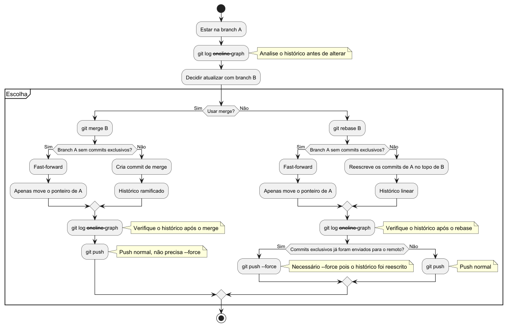

## Guia de Merge vs Rebase no Git 🚀

Documentação prática baseada no diagrama `git-2.puml` (abaixo) para decidir entre `merge` e `rebase`, entender seus efeitos no histórico e executar os comandos com segurança.



### Visão geral

- **Objetivo**: Atualizar a branch `A` com as mudanças da branch `B` de forma segura e consciente.
- **Opções**:
  - **Merge** 🔀: preserva a ramificação do histórico; pode criar um commit de merge.
  - **Rebase** 🔄: reescreve commits para manter o histórico linear; pode exigir `--force` no push.

### Fluxo do diagrama (resumo) 🗺️

1. 🧭 Estar na `branch A`.
2. 👀 Conferir histórico: `git log --oneline --graph`.
3. 🔁 Decidir atualizar a partir da `branch B`.
4. 🔀 Se optar por **merge**:
   - ✅ Se `A` não tem commits exclusivos → **fast-forward** (move apenas o ponteiro).
   - 🔧 Caso contrário → **commit de merge** (histórico ramificado).
   - ⬆️ `git push` normal.
5. 🔄 Se optar por **rebase**:
   - ✅ Se `A` não tem commits exclusivos → **fast-forward**.
   - ✍️ Caso contrário → reescreve os commits de `A` no topo de `B` (histórico linear).
   - 🔎 Revise o histórico e, se já tiver publicado commits reescritos, use `git push --force` (de preferência `--force-with-lease`).
6. ✅ Sempre valide com `git log --oneline --graph` após a operação.

### Quando usar: Merge vs Rebase 🤔

- **Use Merge** 🔀
  - Quando quer preservar o contexto de integração entre branches.
  - Em branches compartilhadas e já publicadas (evita reescrever histórico alheio).
  - Ao integrar `feature` → `main`/`develop` em times que valorizam commits de merge.

- **Use Rebase** 🔄
  - Para manter o histórico **linear** no seu `feature branch` antes de abrir PR.
  - Para “limpar” a história (ex.: squash interativo) antes de compartilhar.
  - Evite rebases em branches já consumidas por outras pessoas (principalmente após push).

### Passo a passo 🧩

#### 1) Preparação

```bash
git checkout A
git fetch origin
git log --oneline --graph --decorate --all -20
```

#### 2) Caminho Merge 🔀

```bash
# Atualizar A a partir de B
git merge B

# Conferir o resultado
git log --oneline --graph --decorate -20

# Publicar
git push
```

- **Fast-forward**: ocorre quando `A` não possui commits exclusivos; o ponteiro avança sem criar commit de merge.
- **Commit de merge**: ocorre quando há divergência; cria um commit unindo as histórias.

#### 3) Caminho Rebase 🔄

```bash
# Reescrever os commits de A no topo de B
git rebase B

# Em caso de conflitos
git status
git add <arquivos-resolvidos>
git rebase --continue
# ou para desistir
git rebase --abort

# Conferir o histórico
git log --oneline --graph --decorate -20
```

##### Push após rebase

- Se você **já tinha publicado** commits que foram reescritos pelo rebase:

```bash
git push --force-with-lease
```

- Caso contrário (nada publicado ainda):

```bash
git push
```

- Por que `--force-with-lease`? 🛡️ Garante que você não sobrescreva commits que outra pessoa empurrou no intervalo.

### Dicas e armadilhas ⚠️

- **Sempre confira o histórico** antes e depois: `git log --oneline --graph`.
- **Rebase com cuidado** em branches compartilhadas; prefira fazer localmente antes do PR.
- **Documente conflitos** resolvidos em mensagens de commit claras.
- **Sincronize frequentemente** com `git fetch` para reduzir conflitos grandes.
- Prefira `--force-with-lease` ao invés de `--force` puro.

### Cheatsheet 🧾

```bash
# Visualizar histórico compacto
git log --oneline --graph --decorate --all -20

# Merge
git checkout A
git merge B
git push

# Rebase
git checkout A
git rebase B
git rebase --continue   # após resolver conflitos
git rebase --abort      # para cancelar
git push --force-with-lease  # se reescreveu histórico já publicado
```

### FAQ (rápido) ❓

- **Como saber se foi fast-forward ou merge commit?**
  - Veja o grafo e a mensagem de commit: fast-forward não cria novo commit; merge cria um commit de integração.

- **Posso rebasear depois de abrir um PR?**
  - Sim, se só você trabalha na branch. Se outras pessoas já basearam trabalho nela, evite.

- **Como desfazer algo que deu errado?**
  - `git reflog` para encontrar o ponto anterior e `git reset --hard <ref>` com cuidado.

---

Feito com base no diagrama `git-2.puml` 🧩. Mantenha o histórico limpo e seguro! ✨


## Entendendo a árvore de commits (`git log --oneline --graph`) 🌳

Ver a "árvore" é essencial quando muitos devs trabalham em paralelo. O comando desenha um grafo ASCII à esquerda, mostrando como os commits se conectam.

### Comando recomendado ▶️

```bash
git log --oneline --graph --decorate --all -20
```

- **--oneline**: uma linha por commit.
- **--graph**: desenha o grafo com caracteres ASCII.
- **--decorate**: mostra referências (ex.: `(HEAD -> main, origin/main, tag)`).
- **--all**: inclui todas as branches locais (e remotas buscadas).

### Lendo o grafo: símbolos e colunas 🔎

- **"*" (asterisco)**: um commit.
- **"|" (barra vertical)**: continuação da mesma linha de histórico (mesma "pista").
- **"\" e "/" (diagonais)**: ramificação (branch) ou junção (merge) entre pistas.
- **"|\" ou "|/"**: ponto onde o histórico se divide (branch) ou converge (merge).
- **Colunas**: cada coluna representa uma pista paralela do grafo, não necessariamente uma branch com nome. As referências de branch aparecem entre parênteses via `--decorate`.
- **Ordem**: de cima para baixo = do commit mais novo para o mais antigo.

### Exemplo 1: histórico linear ➡️

```text
* 3f1a2c1 (HEAD -> main, origin/main) feat: adiciona relatório
* 1a2b3c4 fix: corrige validação
* 0f0e0d0 chore: inicializa projeto
```

- Apenas uma pista (coluna). Não há ramificações.

### Exemplo 2: branch com commits próprios e merge 🔀

```text
*   e3f1a2b (HEAD -> main) Merge branch 'feature/x'
|\  
| *  7c9d1e2 (feature/x) feat: implementa X
| *  5a4b3c2 refactor: extrai componente X
* |  2d3e4f5 fix: hotfix em produção
|/  
*  0a1b2c3 init
```

- Linha 1: `*   e3f1a2b` com dois pais (merge). O espaço após `*` indica múltiplos pais.
- Linha 2: `|\` indica que o histórico se divide em duas pistas (main e feature).
- Linhas 3-4: commits da branch `feature/x` (`*` à direita do `|`).
- Linha 5: `* |` commit na linha da `main` enquanto a feature existia em paralelo.
- Linha 6: `|/` as pistas convergem (merge completado).

### Exemplo 3: dois devs commitando em paralelo 👥

```text
*   9f8e7d6 (HEAD -> develop) Merge 'dev/alice' into 'develop'
|\  
| *  a1b2c3d (dev/alice) feat: upload de avatar
| *  a1b2c3c fix: valida extensão de imagem
* |  8e7d6c5 (dev/bob) feat: cache em memória
| |\
| | *  7d6c5b4 (dev/bob) perf: otimiza lookup
| |/
|/  
*   6c5b4a3 Merge branch 'hotfix/session'
```

- Várias colunas mostram pistas simultâneas. Cada `*` é um commit em uma pista.
- `| |\` indica que, mesmo dentro da pista do Bob, houve uma pequena ramificação (ex.: trabalho local reordenado) e depois `| |/` convergiu.

### Exemplo 4: rebase vs merge (forma do grafo) 🔄 vs 🔀

- Após um **merge**, verá um commit com dois pais e conectores `|\` e `|/`:

```text
*   f1e2d3c (HEAD -> main) Merge branch 'feature/y'
|\  
| *  c3d4e5f (feature/y) feat: Y2
| *  a2b3c4d feat: Y1
|/  
*  9a8b7c6 base
```

- Após um **rebase** da `feature/y` sobre `main`, a história fica linear; os commits da feature aparecem como se tivessem sido feitos diretamente em `main` (sem commit de merge):

```text
*  c3d4e5f (HEAD -> main, feature/y) feat: Y2
*  a2b3c4d feat: Y1
*  9a8b7c6 base
```

### Dicas para não se perder 🧭

- Use `--decorate` para ver claramente em qual commit cada branch aponta.
- Use `--all` quando quiser ver o contexto completo (todas as branches locais).
- Limite o tamanho com `-20` ou `--since="2 weeks ago"` para focar no que importa.
- Para comparar duas branches: `git log --oneline --graph --decorate --left-right main...feature`.
- Quando o grafo estiver "zebrado", foque nas pistas: siga os `|` verticais a partir do commit que você quer entender.

### Mini-legenda 🧾

- `*`: commit
- `|`: continuação da mesma pista
- `|\` e `\`: divisão (branch)
- `|/` e `/`: convergência (merge)
- `(HEAD -> main, origin/main, tagX)`: referências apontando para aquele commit

