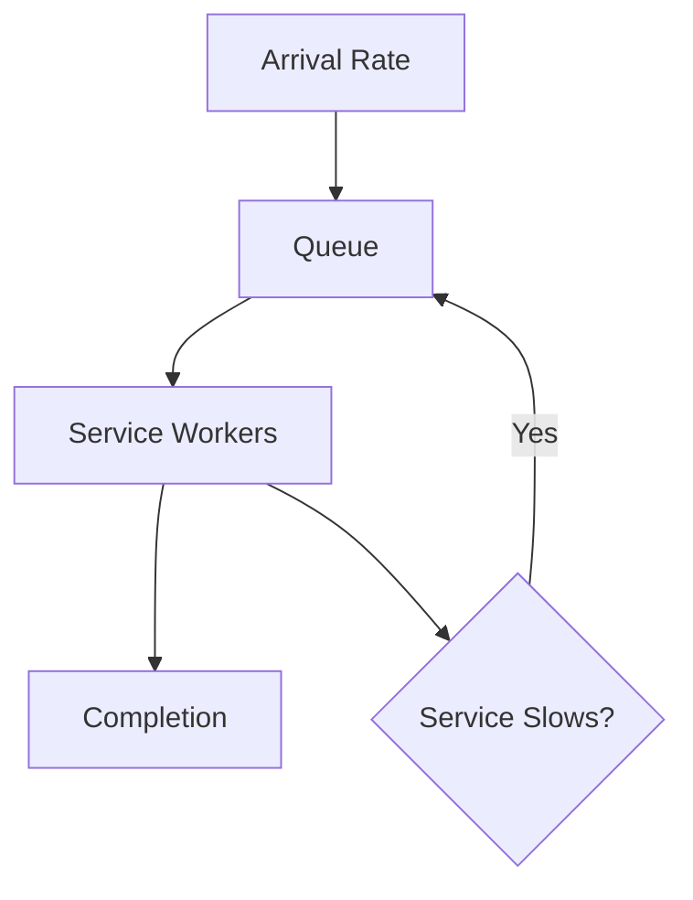

# Performance Fundamentals | Fundamentos de Performance

## Why This Matters | Por que Isso Importa

EN | Performance engineering is the difference between systems that pass tests and systems that survive production.
PT-BR | Engenharia de performance é a diferença entre sistemas que passam em teste e sistemas que sobrevivem em produção.

## Core Terms | Termos Essenciais

| Concept | EN | PT-BR |
|---|---|---|
| Latency | Time to complete one unit of work. | Tempo para completar uma unidade de trabalho. |
| Throughput | Completed units per second. | Unidades concluídas por segundo. |
| Concurrency | Number of in-flight work items. | Número de itens de trabalho em voo. |
| Parallelism | Number of tasks running simultaneously on cores. | Número de tarefas executando simultaneamente em cores. |
| Utilization | Fraction of resource capacity in use. | Fração da capacidade do recurso em uso. |
| Saturation | Queue growth due to demand > service rate. | Crescimento de fila por demanda > taxa de serviço. |
| Tail Latency | p95/p99/p999 behavior for slow users. | Comportamento p95/p99/p999 para usuários lentos. |

## Percentiles over Averages | Percentis em vez de Médias

EN | A stable p50 can hide a catastrophic p99.
PT-BR | Um p50 estável pode esconder um p99 catastrófico.

EN | Production SLOs must be percentile-based.
PT-BR | SLOs de produção devem ser baseados em percentis.

## Queueing Dynamics | Dinâmica de Filas

EN | Queue growth is not neutral; it transforms short slowdowns into long tail latency.
PT-BR | Crescimento de fila não é neutro; ele transforma lentidões curtas em latência de cauda longa.

## Little's Law in Practice | Lei de Little na Prática

$$
L = \lambda \times W
$$

EN | If arrival rate \(\lambda\) rises and service time is unchanged, in-flight work \(L\) increases.
PT-BR | Se a taxa de chegada \(\lambda\) sobe e o tempo de serviço não muda, o trabalho em voo \(L\) aumenta.

EN | If latency \(W\) rises, concurrency pressure rises even without traffic increase.
PT-BR | Se a latência \(W\) sobe, a pressão de concorrência sobe mesmo sem aumento de tráfego.

## Capacity Planning Basics | Fundamentos de Capacity Planning

$$
RequiredInstances \approx \frac{ArrivalRate}{PerInstanceServiceRate \times TargetUtilization}
$$

EN | Keep sustained utilization below 70-80% to absorb bursts.
PT-BR | Mantenha utilização sustentada abaixo de 70-80% para absorver picos.

## Retry Amplification | Amplificação de Retry

$$
RetryAmplification \approx 1 + r + r^2 + ... + r^n
$$

EN | Retries increase load exactly when dependencies are already degraded.
PT-BR | Retries aumentam a carga exatamente quando dependências já estão degradadas.

## Backpressure Principles | Princípios de Backpressure

- EN | Every queue must be bounded.
- PT-BR | Toda fila deve ter limite.
- EN | Every dependency call must have timeout and cancellation.
- PT-BR | Toda chamada de dependência deve ter timeout e cancelamento.
- EN | Degrade gracefully before collapse.
- PT-BR | Degrade graciosamente antes do colapso.

## Decision Table | Tabela de Decisão

| Situation | EN Action | Ação PT-BR |
|---|---|---|
| p99 grows, CPU low | Investigate external IO and queue depth. | Investigar IO externo e profundidade de fila. |
| CPU high, throughput flat | Optimize compute and reduce contention. | Otimizar computação e reduzir contenção. |
| Error bursts under peak | Apply shedding and retry budget. | Aplicar shedding e budget de retry. |
