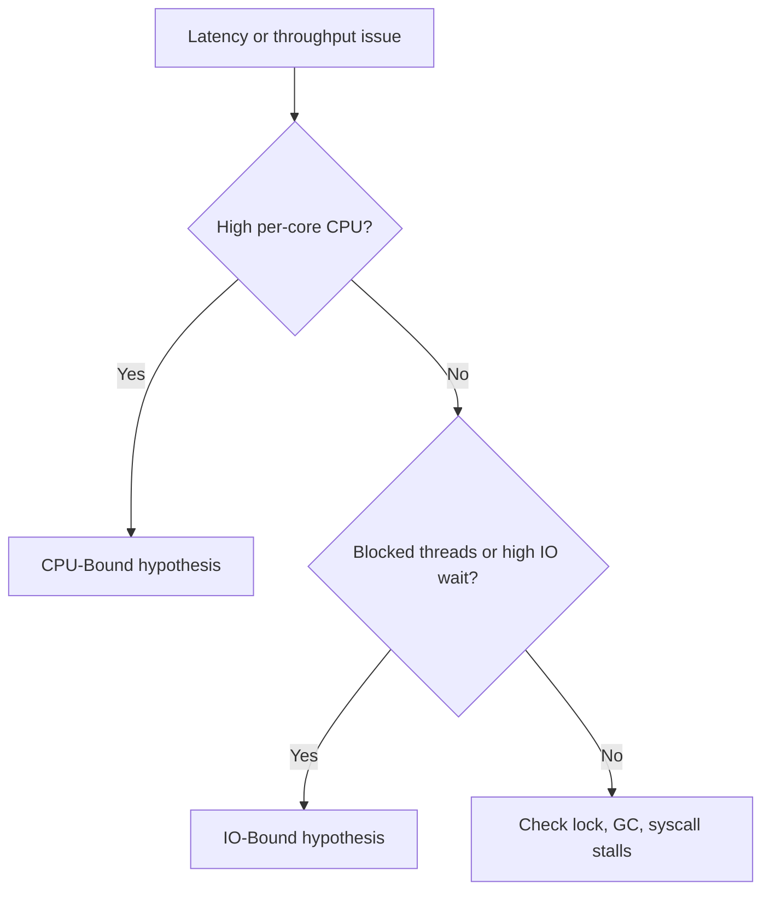

# CPU-Bound vs IO-Bound | CPU-Bound vs IO-Bound

## Definitions | Definições

EN | CPU-bound workloads spend most time computing.
PT-BR | Workloads CPU-bound gastam a maior parte do tempo computando.

EN | IO-bound workloads spend most time waiting on network, disk, database, or queues.
PT-BR | Workloads IO-bound gastam a maior parte do tempo esperando rede, disco, banco ou filas.

## Identification in Production | Identificação em Produção

| Signal | CPU-Bound | IO-Bound |
|---|---|---|
| CPU per core | High and stable | Moderate or low |
| iowait | Usually low | Often elevated |
| Worker state | Runnable/compute heavy | Blocked/waiting |
| Scaling behavior | Limited near core count | Improves with controlled concurrency |
| Tail latency | Worsens with oversubscription | Worsens with dependency slowdown |

## Detection Flow | Fluxo de Detecção

## Anti-Patterns | Anti-padrões

### CPU-Bound Anti-Patterns

- EN | Unbounded threads for compute-heavy work.
- PT-BR | Threads sem limite para trabalho pesado de CPU.
- EN | Parallel streams mixed with blocking remote calls.
- PT-BR | Parallel streams misturados com chamadas remotas bloqueantes.
- EN | Ignoring lock contention in hot paths.
- PT-BR | Ignorar contenção de lock em hot paths.

### IO-Bound Anti-Patterns

- EN | Infinite queue + no timeout.
- PT-BR | Fila infinita + sem timeout.
- EN | Retry storms without jitter and cap.
- PT-BR | Tempestade de retry sem jitter e limite.
- EN | High fan-out without bulkheads.
- PT-BR | Fan-out alto sem bulkheads.

## Correct Decisions | Decisões Corretas

| Scenario | EN | PT-BR |
|---|---|---|
| CPU-bound service | Limit parallelism near effective cores, optimize algorithm and memory layout. | Limitar paralelismo perto dos cores efetivos, otimizar algoritmo e layout de memória. |
| IO-bound aggregator | Use high concurrency with strict timeouts, bulkheads, bounded queues. | Usar alta concorrência com timeouts rígidos, bulkheads e filas limitadas. |

## Real Workload Examples | Exemplos Reais de Workload

- EN | CPU-bound: video transcoding, cryptography, image processing, ranking.
- PT-BR | CPU-bound: transcodificação de vídeo, criptografia, processamento de imagem, ranking.
- EN | IO-bound: API gateway, BFF aggregator, DB-heavy services, message consumers.
- PT-BR | IO-bound: API gateway, agregador BFF, serviços intensivos em banco, consumidores de fila.
