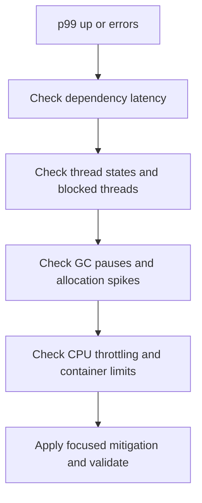

# Java 17-21 Runtime and Resilience | Runtime Java 17-21 e Resiliência

## Threading Models | Modelos de Thread

| Model | EN | PT-BR |
|---|---|---|
| Platform Threads | Better for bounded compute and legacy integration. | Melhor para computação limitada e integração legada. |
| Virtual Threads (Java 21) | Best for high-cardinality IO-bound request-per-task. | Melhor para request-per-task IO-bound de alta cardinalidade. |
| Parallel Streams | Use only for CPU-bound pure transformations. | Use apenas para transformações CPU-bound puras. |

EN | Virtual Threads remove most thread management overhead but do not remove downstream bottlenecks.
PT-BR | Virtual Threads removem grande parte do overhead de thread, mas não removem gargalos de dependências.

## When to Use Virtual Threads | Quando Usar Virtual Threads

- EN | Many concurrent remote calls with strict deadline control.
- PT-BR | Muitas chamadas remotas concorrentes com controle rigoroso de deadline.
- EN | Services limited by waiting time, not CPU.
- PT-BR | Serviços limitados por tempo de espera, não por CPU.

## When Not to Use Virtual Threads | Quando Não Usar Virtual Threads

- EN | CPU-heavy loops expecting throughput gain from more threads.
- PT-BR | Loops pesados de CPU esperando ganho de throughput com mais threads.
- EN | Code that pins carrier threads frequently.
- PT-BR | Código que frequentemente fixa carrier threads.

## GC Strategy in Production | Estratégia de GC em Produção

| Collector | EN use case | Caso de uso PT-BR | Risk | Risco |
|---|---|---|---|---|
| G1 | Balanced default | Padrão equilibrado | Poor tuning can inflate tail latency | Tuning ruim pode inflar latência de cauda |
| ZGC | Very low-pause latency-sensitive services | Serviços sensíveis a pausa muito baixa | Higher overhead in some workloads | Overhead maior em algumas cargas |
| Shenandoah | Large heap, low pause goals | Heap grande com meta de baixa pausa | Version and distro constraints | Restrições por versão e distro |

## JVM Metrics You Must Track | Métricas JVM que Você Deve Acompanhar

- EN | Allocation rate, GC pause distribution, safepoint time.
- PT-BR | Taxa de alocação, distribuição de pausas de GC, tempo de safepoint.
- EN | Live set growth, thread states, blocked time.
- PT-BR | Crescimento do live set, estados de thread, tempo bloqueado.

## Resilience Patterns | Padrões de Resiliência

- EN | Timeout + cancellation on every external call.
- PT-BR | Timeout + cancelamento em toda chamada externa.
- EN | Retry with jitter, cap, and budget.
- PT-BR | Retry com jitter, limite e budget.
- EN | Bulkhead and circuit breaker by dependency.
- PT-BR | Bulkhead e circuit breaker por dependência.

## JVM Troubleshooting Flow | Fluxo de Troubleshooting JVM

