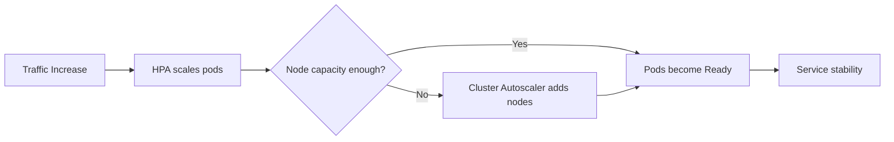

# Kubernetes at Scale | Kubernetes em Escala

## Resource Contracts | Contratos de Recurso

EN | requests define scheduler guarantees; limits define hard caps.
PT-BR | requests definem garantias para o scheduler; limits definem tetos rígidos.

EN | Wrong limits produce CPU throttling and memory eviction patterns.
PT-BR | Limits incorretos produzem padrões de throttling de CPU e evicção de memória.

## QoS and Eviction | QoS e Evicção

| QoS | EN | PT-BR |
|---|---|---|
| Guaranteed | Best eviction protection. | Melhor proteção contra evicção. |
| Burstable | Moderate protection. | Proteção moderada. |
| BestEffort | Highest eviction risk. | Maior risco de evicção. |

## Autoscaling Layers | Camadas de Autoscaling

| Component | EN | PT-BR |
|---|---|---|
| HPA | Scales replicas from metrics. | Escala réplicas com métricas. |
| VPA | Recommends/adjusts resources. | Recomenda/ajusta recursos. |
| Cluster Autoscaler | Scales nodes under scheduling pressure. | Escala nós sob pressão de agendamento. |

EN | Avoid scaling based on CPU only for IO-bound systems; include latency, queue depth, and saturation indicators.
PT-BR | Evite escalar apenas por CPU em sistemas IO-bound; inclua latência, profundidade de fila e indicadores de saturação.

## Probe Strategy | Estratégia de Probes

- EN | startupProbe for slow JVM boot.
- PT-BR | startupProbe para boot lento da JVM.
- EN | readinessProbe gates traffic safely.
- PT-BR | readinessProbe controla entrada de tráfego com segurança.
- EN | livenessProbe for dead process detection, not overloaded process punishment.
- PT-BR | livenessProbe para detectar processo morto, não para punir processo sobrecarregado.

## Availability Controls | Controles de Disponibilidade

- EN | PodDisruptionBudget protects maintenance windows.
- PT-BR | PodDisruptionBudget protege janelas de manutenção.
- EN | topologySpreadConstraints and anti-affinity reduce correlated failures.
- PT-BR | topologySpreadConstraints e anti-affinity reduzem falhas correlacionadas.

## Failure Modes and Mitigation | Modos de Falha e Mitigação

| Failure Mode | EN Mitigation | Mitigação PT-BR |
|---|---|---|
| CPU throttling | Raise CPU limit, tune concurrency, optimize hot path. | Aumentar limite de CPU, ajustar concorrência, otimizar hot path. |
| OOMKilled pods | Correct memory sizing, reduce allocation spikes. | Corrigir sizing de memória, reduzir picos de alocação. |
| Rollout storm | Tune maxUnavailable/maxSurge, stagger traffic warm-up. | Ajustar maxUnavailable/maxSurge, escalonar aquecimento de tráfego. |

## K8s Operations Diagram | Diagrama de Operação K8s

