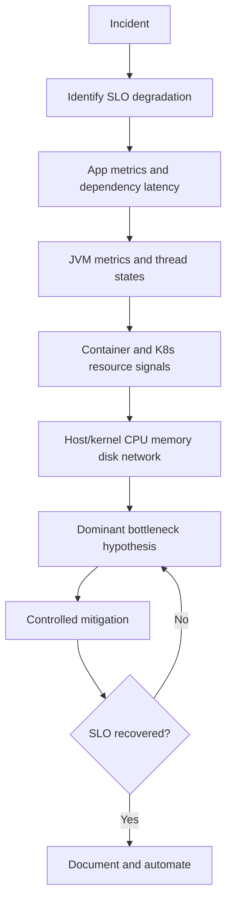

# Operations and Troubleshooting | Operação e Troubleshooting

## Top-Down Playbook | Playbook Top-Down

## Symptom Matrix | Matriz de Sintomas

| Symptom | Layer | Verification | Mitigation |
|---|---|---|---|
| p99 spikes, CPU normal | Dependency/network | Traces and downstream latency | Tighten timeout and reduce fan-out |
| CPU high, throughput flat | Compute/lock | CPU profile + lock stats | Optimize algorithm and lock scope |
| OOMKilled pods | Memory sizing/runtime | Pod events + heap trend | Re-size memory and reduce allocation |
| Error burst on peak | Queue/retry overload | Retry, timeout, queue metrics | Shed load and apply retry budget |

## Incident Timers | Janelas de Incidente

### First 10 minutes | Primeiros 10 minutos

- EN | Confirm which SLI moved first.
- PT-BR | Confirmar qual SLI moveu primeiro.
- EN | Freeze unrelated deploy/config changes.
- PT-BR | Congelar mudanças não relacionadas de deploy/configuração.
- EN | Identify dominant bottleneck (CPU, IO, lock, memory, network).
- PT-BR | Identificar gargalo dominante (CPU, IO, lock, memória, rede).

### First 30 minutes | Primeiros 30 minutos

- EN | Apply safest mitigation: shed, timeout tightening, concurrency cap.
- PT-BR | Aplicar mitigação mais segura: shedding, timeout mais rígido, limite de concorrência.
- EN | Validate effect on p95/p99 and error rate.
- PT-BR | Validar efeito em p95/p99 e taxa de erro.

### First 2 hours | Primeiras 2 horas

- EN | Produce provisional root-cause narrative with evidence.
- PT-BR | Produzir narrativa provisória de causa raiz com evidência.
- EN | Create permanent fix plan and guardrail changes.
- PT-BR | Criar plano de correção definitiva e mudanças de guardrail.

## Command Reference | Referência de Comandos

| Goal | Command | EN | PT-BR |
|---|---|---|---|
| CPU per thread | top -H -p <pid> | Per-thread hot spots. | Hotspots por thread. |
| Scheduler pressure | vmstat 1 | Run queue and context switches. | Run queue e context switches. |
| Disk pressure | iostat -x 1 | Await and queue depth. | Await e profundidade de fila. |
| Socket state | ss -s | Connection pressure view. | Visão da pressão de conexões. |
| K8s events | kubectl get events --sort-by=.lastTimestamp | Probe, eviction, scheduling issues. | Problemas de probe, evicção e agendamento. |
| Pod resources | kubectl top pod -A | Resource saturation by pod. | Saturação de recursos por pod. |
