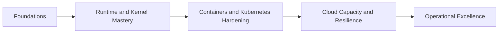

# Scale Readiness and 30-60-90 Roadmap | Scale Readiness e Roadmap 30-60-90

## Scale Readiness Checklist | Checklist de Prontidão para Escala

- [ ] EN | Defined SLOs with p95/p99 latency and error budget.
- [ ] PT-BR | SLOs definidos com latência p95/p99 e budget de erro.
- [ ] EN | Bounded concurrency at every critical dependency.
- [ ] PT-BR | Concorrência limitada em toda dependência crítica.
- [ ] EN | Timeouts and cancellation propagated end-to-end.
- [ ] PT-BR | Timeouts e cancelamento propagados ponta a ponta.
- [ ] EN | Retry policy with jitter, cap, idempotency, and budget.
- [ ] PT-BR | Política de retry com jitter, limite, idempotência e budget.
- [ ] EN | Resource requests/limits tuned from load tests.
- [ ] PT-BR | requests/limits ajustados com base em testes de carga.
- [ ] EN | Dashboards for app, JVM, container, K8s, host, dependencies.
- [ ] PT-BR | Dashboards para app, JVM, container, K8s, host e dependências.
- [ ] EN | Incident runbooks validated in game days.
- [ ] PT-BR | Runbooks de incidente validados em game days.

## 30-60-90 Plan | Plano 30-60-90

### Day 1-30 | Dias 1-30

- EN | Build OS and performance fundamentals (queueing, Linux scheduling, memory, IO).
- PT-BR | Construir fundamentos de SO e performance (filas, scheduler Linux, memória, IO).
- EN | Instrument JVM metrics and baseline service behavior.
- PT-BR | Instrumentar métricas JVM e baseline do comportamento do serviço.

### Day 31-60 | Dias 31-60

- EN | Harden Docker and K8s resource policies (requests/limits/probes/PDB).
- PT-BR | Endurecer políticas de recurso em Docker e K8s (requests/limits/probes/PDB).
- EN | Implement timeout, cancellation, bulkhead, retry budget patterns.
- PT-BR | Implementar padrões de timeout, cancelamento, bulkhead e budget de retry.

### Day 61-90 | Dias 61-90

- EN | Run controlled load and failure tests (dependency slowdown, AZ loss, pod churn).
- PT-BR | Executar testes controlados de carga e falha (lentidão de dependência, perda de AZ, churn de pods).
- EN | Close gaps with permanent guardrails and documented runbooks.
- PT-BR | Fechar lacunas com guardrails permanentes e runbooks documentados.

## Learning Sequence Diagram | Diagrama da Sequência de Aprendizado

## Reference Set | Conjunto de Referências

- Tanenbaum, Modern Operating Systems
- OSTEP, Operating Systems: Three Easy Pieces
- Brendan Gregg, Systems Performance
- Linux Kernel Documentation
- Java JEPs 17-21
