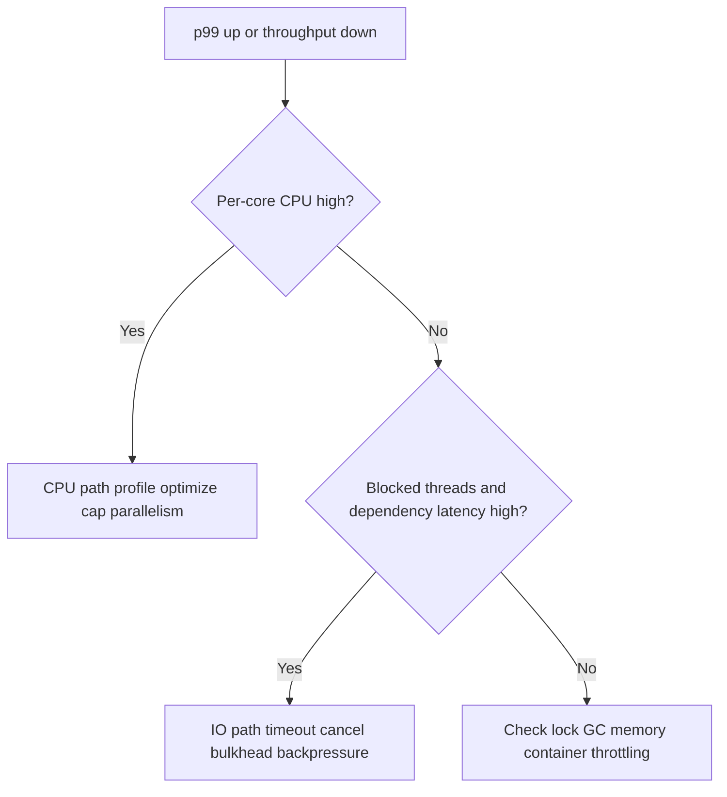

# Java Concurrency and Parallelism Playbook | Playbook de Concorrencia e Paralelismo em Java

## Executive Analysis | Analise Executiva

EN | Most production failures under high load are queueing and contention failures, not raw CPU shortages.
PT-BR | A maioria das falhas em producao sob alta carga e falha de fila e contencao, nao falta bruta de CPU.

EN | Use concurrency to hide wait time (IO-bound), use parallelism to split compute (CPU-bound), and use neither when sequential cost is tiny and dependency count is low.
PT-BR | Use concorrencia para esconder tempo de espera (IO-bound), use paralelismo para dividir computacao (CPU-bound), e nao use nenhum dos dois quando o custo sequencial e pequeno e o numero de dependencias e baixo.

## Decision Matrix | Matriz de Decisao

| Scenario | Use Concurrency? | Use Parallelism? | Why | Por que |
|---|---|---|---|---|
| API aggregator calling 5 downstream services | Yes | No | Waiting dominates time. | Tempo de espera domina. |
| Image hashing / scoring engine | Maybe | Yes | Compute dominates time. | Computacao domina. |
| Simple CRUD with one DB query and light mapping | No | No | Overhead > benefit. | Overhead > beneficio. |
| Batch ETL with heavy transformation per record | Yes | Yes (bounded) | Both waiting and compute exist. | Existe espera e computacao. |

## How to Identify Bottlenecks | Como Identificar Gargalos

### Signals by bottleneck type | Sinais por tipo de gargalo

| Bottleneck | Signals | How to verify | Como verificar |
|---|---|---|---|
| CPU-bound | High per-core CPU, throughput plateaus, low iowait | CPU profile, per-core metrics | Perfil de CPU, metricas por core |
| IO-bound | High latency with moderate CPU, many blocked threads | Thread dump, dependency latency, timeout metrics | Thread dump, latencia de dependencia, metricas de timeout |
| Lock contention | High blocked/waiting threads, futex pressure | JFR lock events, async-profiler lock view | Eventos de lock no JFR, visao de lock no async-profiler |
| Memory/GC pressure | Allocation spikes, GC pause inflation, p99 spikes | GC logs, allocation profiling | Logs de GC, profiling de alocacao |

### Troubleshooting flow | Fluxo de troubleshooting



## Real Scenario 1: High-Concurrency IO Aggregator | Cenario Real 1: Agregador IO com Alta Concorrencia

EN | Goal: abort safely under overload and avoid downstream collapse.
PT-BR | Objetivo: abortar com seguranca sob sobrecarga e evitar colapso de downstream.

### Pure Java 21 (Virtual Threads + bulkhead + timeout)

```java
import java.net.URI;
import java.net.http.HttpClient;
import java.net.http.HttpRequest;
import java.net.http.HttpResponse;
import java.time.Duration;
import java.util.List;
import java.util.concurrent.*;

public class IoAggregatorFailFast {
    private static final HttpClient CLIENT = HttpClient.newBuilder()
            .connectTimeout(Duration.ofMillis(150))
            .build();

    private static final Semaphore BULKHEAD = new Semaphore(200);

    public static void main(String[] args) throws Exception {
        List<String> urls = List.of(
                "https://example.com/a",
                "https://example.com/b",
                "https://example.com/c"
        );

        try (var exec = Executors.newVirtualThreadPerTaskExecutor()) {
            var futures = urls.stream().map(u -> exec.submit(() -> callWithBudget(u))).toList();
            for (Future<Integer> f : futures) {
                try {
                    System.out.println(f.get(300, TimeUnit.MILLISECONDS));
                } catch (TimeoutException e) {
                    // Abort this unit quickly; fail-fast keeps tail latency controlled.
                    System.out.println("timeout");
                }
            }
        }
    }

    static int callWithBudget(String url) throws Exception {
        if (!BULKHEAD.tryAcquire(20, TimeUnit.MILLISECONDS)) {
            throw new RejectedExecutionException("bulkhead full");
        }
        try {
            HttpRequest req = HttpRequest.newBuilder()
                    .uri(URI.create(url))
                    .timeout(Duration.ofMillis(250))
                    .GET()
                    .build();
            return CLIENT.send(req, HttpResponse.BodyHandlers.discarding()).statusCode();
        } finally {
            BULKHEAD.release();
        }
    }
}
```

### Spring Boot fail-fast endpoint

```java
import org.springframework.http.HttpStatus;
import org.springframework.http.ResponseEntity;
import org.springframework.web.bind.annotation.GetMapping;
import org.springframework.web.bind.annotation.RestController;

import java.util.concurrent.RejectedExecutionException;

@RestController
public class AggregateController {
    private final AggregationService service;

    public AggregateController(AggregationService service) {
        this.service = service;
    }

    @GetMapping("/aggregate")
    public ResponseEntity<?> aggregate() {
        try {
            return ResponseEntity.ok(service.aggregate());
        } catch (RejectedExecutionException ex) {
            // Explicit overload signal is better than queueing forever.
            return ResponseEntity.status(HttpStatus.TOO_MANY_REQUESTS).body("overloaded");
        } catch (Exception ex) {
            return ResponseEntity.status(HttpStatus.BAD_GATEWAY).body("dependency failure");
        }
    }
}
```

EN | Why this works: bounded concurrency, fast rejection, and strict deadlines prevent retry storms and queue explosions.
PT-BR | Por que funciona: concorrencia limitada, rejeicao rapida e deadlines rigidos evitam tempestade de retry e explosao de filas.

## Real Scenario 2: CPU-Bound Parallel Processing | Cenario Real 2: Processamento CPU-Bound Paralelo

EN | Goal: maximize throughput without oversubscribing cores.
PT-BR | Objetivo: maximizar throughput sem oversubscription de cores.

```java
import java.util.List;
import java.util.concurrent.*;

public class CpuParallelBounded {
    public static void main(String[] args) throws Exception {
        int cores = Runtime.getRuntime().availableProcessors();
        ForkJoinPool pool = new ForkJoinPool(Math.max(1, cores - 1));

        List<Long> data = java.util.stream.LongStream.range(1, 30_000_000).boxed().toList();

        long start = System.nanoTime();
        long result = pool.submit(() -> data.parallelStream()
                .mapToLong(CpuParallelBounded::mix)
                .sum()).get();

        long elapsedMs = TimeUnit.NANOSECONDS.toMillis(System.nanoTime() - start);
        System.out.println("result=" + result + " elapsedMs=" + elapsedMs);
        pool.shutdown();
    }

    static long mix(long x) {
        x ^= (x << 13);
        x ^= (x >>> 7);
        x ^= (x << 17);
        return x;
    }
}
```

EN | Rule: for CPU-bound tasks, adding threads after core saturation only increases context switches.
PT-BR | Regra: para tarefas CPU-bound, adicionar threads apos saturacao de cores apenas aumenta context switch.

## Scenario 3: When You Need Neither | Cenario 3: Quando Nao Precisa de Nenhum

EN | Example: service does a single indexed DB read plus lightweight mapping (<5 ms median).
PT-BR | Exemplo: servico faz uma unica leitura indexada no banco com mapeamento leve (<5 ms mediana).

EN | Adding concurrency/parallelism increases complexity and overhead with no measurable gain.
PT-BR | Adicionar concorrencia/paralelismo aumenta complexidade e overhead sem ganho mensuravel.

Use simple synchronous code. | Use codigo simples sincrono.

```java
public UserDto getUser(String id) {
    User entity = repository.findById(id).orElseThrow();
    return new UserDto(entity.getId(), entity.getName());
}
```

## How to Resolve Bottlenecks | Como Resolver Gargalos

### CPU-bound resolution | Resolucao para CPU-bound

- EN | Optimize algorithmic complexity first.
- PT-BR | Otimizar complexidade algoritmica primeiro.
- EN | Reduce allocations and object churn.
- PT-BR | Reduzir alocacoes e churn de objetos.
- EN | Cap parallelism near available cores.
- PT-BR | Limitar paralelismo perto dos cores disponiveis.

### IO-bound resolution | Resolucao para IO-bound

- EN | Enforce timeout and cancellation on every call.
- PT-BR | Aplicar timeout e cancelamento em toda chamada.
- EN | Use bulkhead per dependency and bounded queues.
- PT-BR | Usar bulkhead por dependencia e filas limitadas.
- EN | Use jittered retries with strict retry budget.
- PT-BR | Usar retry com jitter e budget estrito.

### Lock/contention resolution | Resolucao para lock/contencao

- EN | Shorten critical sections.
- PT-BR | Encurtar secoes criticas.
- EN | Reduce shared mutable state.
- PT-BR | Reduzir estado mutavel compartilhado.
- EN | Replace global lock with partitioned lock where possible.
- PT-BR | Trocar lock global por lock particionado quando possivel.

## Senior Checklist | Checklist de Senior

- [ ] EN | Did I classify workload type correctly before coding?
- [ ] PT-BR | Classifiquei corretamente o tipo de workload antes de codar?
- [ ] EN | Are queues bounded and overload handled explicitly?
- [ ] PT-BR | As filas estao limitadas e a sobrecarga e tratada explicitamente?
- [ ] EN | Are p95/p99 and error budget protected under peak?
- [ ] PT-BR | p95/p99 e budget de erro estao protegidos sob pico?
- [ ] EN | Is added concurrency producing measured gain, not just complexity?
- [ ] PT-BR | A concorrencia adicionada gera ganho medido, e nao apenas complexidade?
