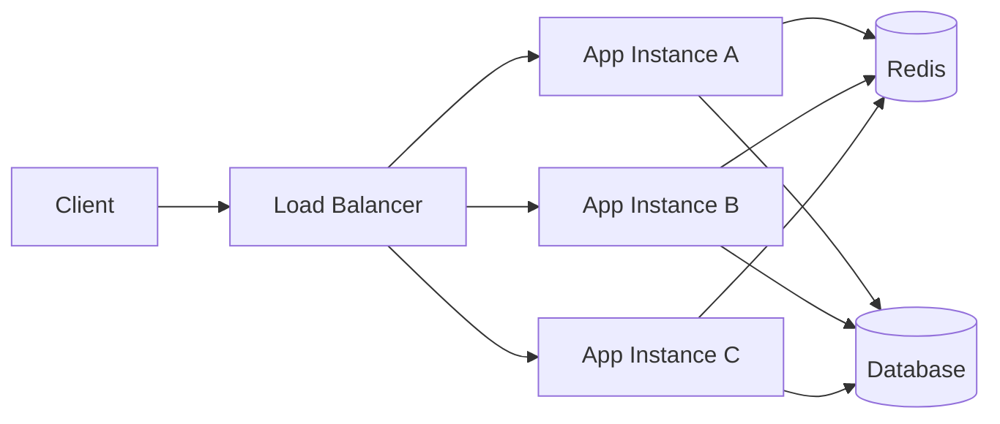

# 🌐 Horizontal Scaling and Stateless Service Design

Stateless services are easier to scale out under high traffic because any instance can process any request.

## 📋 Summary

- [What stateless means](#what-stateless-means)
- [Core design principles](#core-design-principles)
- [Session and state strategies](#session-and-state-strategies)
- [Scaling architecture](#scaling-architecture)
- [Reliability patterns at high volumetry](#reliability-patterns-at-high-volumetry)
- [Operational checklist](#operational-checklist)

## What stateless means

A stateless service does not keep request-specific session state in local process memory between requests.

Examples:

- Good: auth token is validated per request.
- Risky: in-memory session map on one pod/instance.

## Core design principles

- Keep API servers ephemeral and replaceable.
- Store shared state in external systems (DB, Redis, object storage).
- Use idempotent handlers when possible.
- Make retries safe (idempotency keys, deduplication).
- Separate compute from state.

## Session and state strategies

- JWT or signed tokens for session context.
- Redis for short-lived shared session/cache data.
- Database for durable state.
- Message queues for asynchronous workloads.

## Scaling architecture

Typical flow:

1. Load balancer distributes requests across instances.
2. Stateless app instances process requests.
3. Shared datastores provide persistence.
4. Autoscaler adjusts replica count using CPU/RPS/latency.

Mermaid view:

## Reliability patterns at high volumetry

- Timeouts everywhere (client, server, DB, external APIs).
- Circuit breaker for unstable dependencies.
- Bulkheads to isolate heavy workloads.
- Rate limiting to protect critical paths.
- Load shedding when saturation is detected.
- Graceful shutdown with in-flight request draining.

## Operational checklist

- [ ] No local state required for request continuity.
- [ ] Health checks (`/live`, `/ready`) configured.
- [ ] HPA/autoscaling policy tuned with real traffic metrics.
- [ ] Request timeout, retry, and circuit breaker policies defined.
- [ ] SLOs for latency/error rate set and monitored.
- [ ] Load/stress tests validate scale-out behavior.
